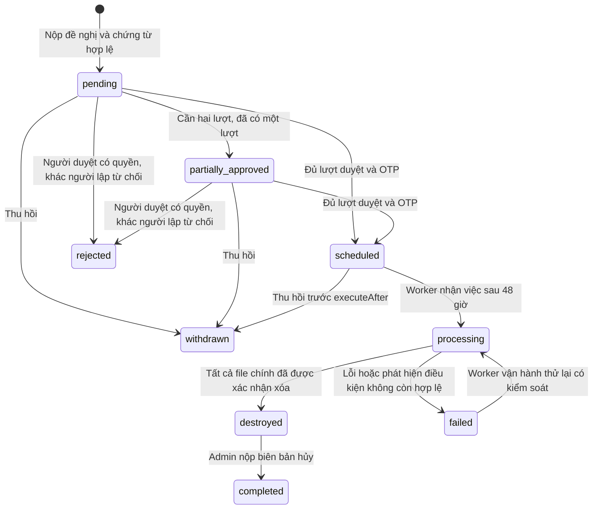

# Quy trình hủy hồ sơ — hợp đồng tích hợp backend v1

Frontend đã có `pages/destruction.html`, menu Hủy hồ sơ cho Admin/Trưởng khoa, menu Yêu cầu hủy hồ sơ cho User và liên kết Đã hủy trong Kho lưu trữ. Tài liệu này là yêu cầu triển khai API, **không phải backend đã chạy**. Không có SQL migration, worker, dịch vụ OTP hay quyền truy cập SAN trong repository frontend này.

## Phạm vi và nguyên tắc

- Hủy các **hồ sơ/tài liệu cụ thể**, không xóa danh mục `document_types`.
- Server quyết định quyền, điều kiện, thời gian và trạng thái. Không tin role trong localStorage, `allowedActions` gửi lại, checksum, danh sách snapshot hoặc giờ của trình duyệt.
- Không cung cấp nút xóa vật lý trực tiếp. Khi API chưa sẵn sàng, frontend thông báo và khóa lập/duyệt/hủy; không giả lập thành công.
- Không `DELETE documents`, không cascade xóa audit log. `documents.status = destroyed` sau khi việc xóa nội dung thực tế thành công. Kho Đã hủy chỉ trả metadata.
- Backend chặn mọi đường đọc nội dung của hồ sơ đã hủy: preview, download, phiên bản cũ, OCR, thumbnail, export, đường dẫn tĩnh, link đã ký. Metadata và chứng từ hủy vẫn đọc được theo quyền.
- Điều kiện đủ: `retention_until <= thời gian server`, có thời hạn xác định, không bảo quản vĩnh viễn, `legal_hold = false`, trạng thái stored/approved, không thuộc đề nghị đang hoạt động. Trưởng khoa chỉ chọn trong khoa mình.
- Kiểm tra lại điều kiện khi lập, duyệt và ngay trước khi worker xóa. Thay đổi legal hold phải đồng bộ khóa với worker; không được bật legal hold sau khi file đã bắt đầu xóa và vẫn báo thành công.

## Trạng thái



`draft` là trạng thái dự phòng cho dữ liệu backend; phiên bản frontend này nộp trực tiếp `pending`, chưa có lưu/sửa bản nháp. `destroyed` và `completed` của đề nghị đều có documents ở trạng thái `destroyed`. Không có thao tác khôi phục nội dung sau processing/destroyed. Thử lại chỉ tiếp tục phần chưa hoàn thành, không chạy lại toàn bộ một cách mù quáng.

Lịch `executeAfter` do server tính **48 giờ sau lượt duyệt cuối cùng**. Không tạo lịch sau lượt duyệt thứ nhất nếu cần hai người. Thu hồi chỉ thành công khi server thấy chưa đến hạn và chưa có worker nhận việc. Dùng transaction/row lock/compare-and-set để thu hồi và worker không thắng đồng thời. Không dùng timer của browser để xóa file.

## Phân quyền và OTP

- User chỉ được gửi yêu cầu cho hồ sơ do mình tải lên **và** thuộc khoa mình; thiếu thông tin người tải hoặc khoa phải từ chối. Backend kiểm tra từng hồ sơ khi nhận POST, không tin bộ lọc frontend.
- User chỉ xem danh sách, chi tiết và chứng từ của yêu cầu do mình lập khi mọi hồ sơ vẫn do mình tải lên và thuộc khoa mình. Server lọc trước phân trang/tính tổng; kiểm tra quyền trên cả API chi tiết và nội dung chứng từ, kể cả khi biết ID. User được thu hồi yêu cầu của mình theo trạng thái và `allowedActions`; không được duyệt, từ chối hoặc đóng hồ sơ. API Đã hủy và đủ điều kiện cũng lọc theo người tải và khoa trước phân trang.
- Giữ quy tắc duyệt: hồ sơ thường cần Admin hoặc Trưởng khoa; hồ sơ mật cần cả Admin và Trưởng khoa. Frontend không tự tính hay ghi đè requiredApprovals của server.

- Trưởng khoa/Admin có thể lập; backend kiểm tra quyền với từng hồ sơ.
- Người lập không được tự duyệt, ngoại trừ Trưởng khoa tự lập đề nghị cho hồ sơ thường do mình tải lên và thuộc khoa mình: được tự duyệt bằng OTP nếu server cấp `approve`. Frontend chỉ mở ngoại lệ khi role là department_head, requiredApprovals = 1 và allowedActions có approve; quyền sở hữu và khoa do server kiểm tra. Không tự từ chối đề nghị mình lập. Mỗi người chỉ được ghi nhận một lượt duyệt.
- Chính sách mức mật cần thống nhất với đơn vị. Giao diện hiện dùng `normal` (Thường), `confidential` (Mật), `secret` (Tối mật); dữ liệu cũ có thể có `top_secret`. Không tạo thêm mức Hạn chế/Nghiêm ngặt trên frontend.
- Admin được duyệt theo vai trò. Trưởng khoa được duyệt khi toàn bộ hồ sơ trong đề nghị thuộc khoa mình và trong phạm vi được xem. Backend kiểm tra phạm vi và trả `allowedActions` riêng cho người dùng; frontend không suy luận quyền từ metadata khoa có thể thiếu trong chi tiết.
- Hồ sơ thường cần một lượt duyệt từ Admin hoặc Trưởng khoa của hồ sơ, có ngoại lệ tự duyệt ở trên. Hồ sơ mật/tối mật/tuyệt mật cần Trưởng khoa của hồ sơ và Admin, là hai người khác nhau và khác người lập; hai Admin hoặc hai Trưởng khoa không thay thế được cặp vai trò này. Hồ sơ mật khác khoa phải tách đề nghị. Backend tính `requiredApprovals` và cấp `allowedActions` theo vai trò còn thiếu; không yêu cầu quyền Admin cấp cao riêng. Không dùng `Auth.hasPermission` để thay thế quyết định quyền của backend.
- `allowedActions` là danh sách hành động server cho phép với tài khoản hiện tại. Frontend còn chặn tự duyệt, duyệt lặp, sai vai trò/trạng thái; server bắt buộc kiểm tra lại.
- OTP challenge ngắn hạn, giới hạn lần thử và tần suất cấp mã, không trả OTP qua API, không ghi OTP vào log. Ràng buộc actor + request + purpose + version + digest danh sách hồ sơ/chứng từ/quyết định/chính sách backup. Tiêu thụ một lần trong cùng transaction duyệt. OTP của tài khoản/đề nghị khác không dùng được.
- Hỗ trợ OTP số 6–8 ký tự theo giao diện; có thể cấp mã ngoài băng hoặc kiểm tra TOTP của tài khoản đã đăng ký. Challenge trả hướng dẫn tương ứng. Chữ ký số PDF là kiểm tra khác với OTP và chỉ thông báo đã xác minh khi có kết quả kiểm tra thực tế.

## Dữ liệu cần migration

Tên DB dùng snake_case; JSON API dưới đây dùng camelCase. Đảm bảo migration hỗ trợ enum status hiện có và không phá FK.

| Bảng | Dữ liệu tối thiểu |
| --- | --- |
| documents | retention_until nullable timestamp UTC, legal_hold boolean NOT NULL default false, destroyed_at nullable, status bổ sung destroyed; giữ title, code, original_filename, size, checksum, destruction_request_id |
| destruction_requests | id, code unique, reason, decision_number, decision_date (date), status, created_by, created_at, required_approvals, execute_after, destroyed_at, completed_at, completed_by, version, backup_policy_snapshot/version, backup_disposition_notes, failure_reason |
| destruction_items | request_id, document_id FK RESTRICT, snapshot title/code/size, checksum khi đề nghị, checksum_at_destruction, version/hash nội dung, status, destroyed_at, execution_result; unique request_id + document_id |
| destruction_attachments | id, request_id, type decision/council_minutes/destruction_minutes, filename, immutable object key, size, sha256, uploaded_by, created_at, signature_validation_result (nếu hỗ trợ); append-only |
| destruction_approvals | request_id, user_id, approved_at, version/digest, otp_challenge_id; unique request_id + user_id |
| destruction_otp_challenges | id, request_id, actor_id, purpose, bound_version/digest, expires_at, attempt_count, consumed_at; chỉ lưu dữ liệu kiểm tra mã an toàn |
| destruction_jobs | request_id unique, run_at, status, lease_owner/expiry, attempts, checkpoint, last_error; dùng outbox/transaction để không mất lịch |
| destruction_backup_dispositions | request_id, document_id, target external/cloud/nas, object/version keys, status, excluded_at, purge_due_at, purged_at, evidence/error |
| audit_logs | append-only; actor, action, request/document ids, server timestamp, old/new status, digest/chứng từ, kết quả; không chứa OTP/token |

Ràng buộc duy nhất cho một hồ sơ trong **một đề nghị đang hoạt động** cần được backend thực hiện bằng khóa tài liệu hoặc bảng claim unique document_id, giải phóng claim khi rejected/withdrawn. Không dùng unique document_id toàn bộ destruction_items vì sẽ chặn lập lại sau thu hồi/từ chối. Không cho sửa nội dung/phiên bản hồ sơ khi đang có đề nghị hoạt động; nếu cần sửa, thu hồi và lập lại để chứng từ/snapshot không sai.

Không tự gán retention_until từ ngày upload. Backend/migration phải tính từ mốc và thời hạn bảo quản đã được phê duyệt theo loại hồ sơ; thiếu dữ liệu thì không đủ điều kiện hủy. Quản lý legal hold/retention là trách nhiệm backend và quy trình quản trị hiện có; không thêm nút bỏ legal hold vào form hủy.

## Quy ước HTTP

- Base URL dùng `API` hiện có trong app.js. Tất cả đường dẫn mới bắt đầu `/destruction`.
- JWT `Authorization: Bearer ...` trên mọi API, kể cả file chứng từ; server kiểm tra quyền cấp đối tượng, khoa và vai trò tại mỗi lần gọi.
- JSON trả trực tiếp hoặc bọc `{ "data": ... }`. Lỗi `{ "code": "...", "message": "Thông báo tiếng Việt" }`.
- List trả `{ items: [], page: 1, pageSize: 20, total: 0 }`, page/pageSize/total là integer. Áp giới hạn pageSize ở server; filter/sort trước khi phân trang; chỉ trả dữ liệu người dùng có quyền xem.
- Mọi mutation trạng thái dùng POST, `If-Match: "<version>"` (trừ tạo mới) và `Idempotency-Key`. Frontend giữ key cho lần gửi lại cùng form, đổi key khi sửa nội dung. Challenge OTP dùng If-Match nhưng không có Idempotency-Key.
- Idempotency key gắn actor + endpoint + digest payload. Ghi mutation, kết quả và audit nguyên tử; retry cùng key trả kết quả đã lưu, không tạo thêm đề nghị/approval/chứng từ. Cùng key khác payload trả 409. Kiểm tra replay đã thành công trước If-Match, vì retry sau thành công mang version cũ. Không cache lỗi OTP/validation thành công giả.
- 401 hết phiên; 403 không đủ quyền; 404 không tồn tại/không được thấy; 409 xung đột, hồ sơ đang được đề nghị hoặc thay đổi chính sách; 412 version cũ; 413 quá dung lượng; 422 không đủ điều kiện/PDF không hợp lệ; 429 giới hạn OTP. Frontend hiện thông báo lỗi, người dùng tải lại chi tiết khi gặp xung đột.
- CORS cho origin frontend: GET/POST/OPTIONS; header Authorization, Content-Type, If-Match, Idempotency-Key. HTTPS khi triển khai, Cache-Control: no-store cho nội dung/chứng từ nhạy cảm.

## 1. Kiểm tra dịch vụ

`GET /destruction/capabilities`

```json
{
  "enabled": true,
  "canCreate": true,
  "serverTime": "2026-10-19T03:00:00Z",
  "waitHours": 48,
  "maxPdfBytes": 26214400,
  "maxItemsPerRequest": 100,
  "backupPolicy": {
    "version": "backup-policy-2026-01",
    "targets": [
      { "key": "external", "label": "Ổ ngoài", "purgeWithinDays": 30, "notes": "Ví dụ cấu hình; phải thay bằng chính sách thực tế." },
      { "key": "cloud", "label": "Cloud", "purgeWithinDays": 30, "notes": "Bao gồm các object version." },
      { "key": "nas", "label": "NAS", "purgeWithinDays": 30, "notes": "Bao gồm snapshot theo chính sách đã thống nhất." }
    ]
  }
}
```

Giá trị 30 ngày là **ví dụ**, không phải thời hạn đã được chốt. Không bật enabled nếu chưa có OTP/worker/kho chứng từ/chính sách backup hoạt động. Frontend yêu cầu đủ ba đích và chính sách có version. Trả serverTime mới tại mỗi lần gọi. `canCreate` boolean thực sự, không dùng chuỗi.

## 2. Chọn hồ sơ

`GET /destruction/eligible-documents?q=...&page=1&pageSize=20`

Một phần tử `items`:

```json
{
  "id": "doc-123", "code": "HS-123", "title": "Hồ sơ năm 2020",
  "documentType": { "id": "type-1", "name": "Loại hồ sơ" },
  "status": "stored", "securityLevel": "normal",
  "retentionUntil": "2025-12-31T16:59:59Z", "legalHold": false,
  "activeDestructionRequestId": null, "eligible": true
}
```

Endpoint này trả danh sách đủ điều kiện và đúng phạm vi khoa. `q` tìm theo tên/mã/loại hồ sơ.

Giao diện lập đề nghị hiện tìm trong kho qua `GET /documents/search?limit=10000` (cùng nguồn với trang Hồ sơ), lọc tên/mã/loại không dấu và phân trang 20 dòng ở frontend. Giới hạn tải giống trang kho hiện tại; nếu kho vượt giới hạn này, cần bổ sung tìm kiếm/phân trang server theo hợp đồng API thực tế. Chỉ hiển thị hồ sơ stored/approved; khóa lựa chọn nếu có legalHold hoặc activeDestructionRequestId. Chuẩn hóa id/_id/documentId. Hồ sơ thiếu dữ liệu điều kiện hủy hoặc chưa hết hạn vẫn có thể chọn để lập đề nghị; giao diện không khẳng định đã đủ điều kiện hủy.

API tạo đề nghị phải kiểm tra quyền theo khoa, retention/legal hold/trạng thái/claim với từng ID và trả lỗi rõ lý do nếu không hợp lệ. Việc chọn ở frontend không thay đổi điều kiện server: backend hiện vẫn có thể từ chối hồ sơ chưa hết hạn. Nếu nghiệp vụ cho phép nộp đề nghị ngoại lệ trước hạn thì backend cần hỗ trợ quy trình đó riêng, không bỏ kiểm tra khi duyệt hoặc thực hiện hủy.

## 3. Nộp đề nghị và chứng từ nguyên tử

`POST /destruction/requests` — multipart/form-data, Idempotency-Key, KHÔNG tự đặt Content-Type vì cần boundary.

| Field | Ý nghĩa |
| --- | --- |
| documentIds | JSON string mảng ID; ít nhất một, không trùng, tối đa maxItemsPerRequest |
| reason | string trim 1–4000 |
| decisionNumber | string trim 1–100 |
| decisionDate | YYYY-MM-DD |
| decisionFile | bắt buộc, PDF quyết định có dấu/chữ ký |
| councilMinutesFile | PDF biên bản họp, tùy chọn |
| signedDocumentConfirmed | chuỗi "true", xác nhận của người lập, không phải chứng minh chữ ký đã được kiểm tra |
| backupPolicyVersion | phải khớp policy đang có hiệu lực |

Trả `201 { "id": "request-1", "code": "HUY-2026-0001", "status": "pending", "version": 1 }`.

Server kiểm tra toàn bộ hồ sơ trong transaction, tạo snapshot từ DB, lưu chứng từ và hash từ bytes thực, ghi audit. Cấm chỉ tạo thành công một phần danh sách. Nếu lưu object ngoài DB, upload tạm rồi commit/publish nguyên tử theo saga/outbox; rollback dọn object tạm, không để đề nghị pending thiếu quyết định. Khi trả lỗi không được có đề nghị khả dụng nửa vời.

PDF phải được kiểm tra nội dung thực, loại file, kích thước, mã độc và khả năng đọc; header %PDF- của frontend chỉ là kiểm tra ban đầu. Nếu có kiểm tra ký số, lưu kết quả hợp lệ/không hợp lệ/không có/chưa kiểm tra, chuỗi chứng thư và thời điểm kiểm tra theo chính sách. Scan có dấu/chữ ký tay vẫn cần người duyệt xem, không thể kết luận từ extension/MIME.

## 4. Danh sách và chi tiết

`GET /destruction/requests?status=&page=1&pageSize=20`

List items gồm id, code, decisionNumber, createdBy `{ id, fullName }`, status, approvalCount, requiredApprovals, executeAfter. Lọc trạng thái trống = tất cả được cấp quyền.

`GET /destruction/requests/:id` trả:

```json
{
  "id": "request-1", "code": "HUY-2026-0001", "version": 1,
  "status": "pending", "reason": "Hết thời hạn bảo quản",
  "decisionNumber": "123/QD", "decisionDate": "2026-10-19",
  "createdBy": { "id": "user-1", "fullName": "Người lập" },
  "createdAt": "2026-10-19T03:00:00Z", "executeAfter": null,
  "requiredApprovals": 1, "approvals": [],
  "allowedActions": ["approve", "reject"],
  "items": [{
    "documentId": "doc-123", "title": "Hồ sơ năm 2020", "code": "HS-123",
    "sizeBytes": 102400, "checksum": "<64 ký tự hex>",
    "checksumAtDestruction": null, "status": "pending", "destroyedAt": null
  }],
  "attachments": [{
    "id": "att-1", "type": "decision", "filename": "quyet-dinh.pdf",
    "sha256": "<64 ký tự hex>", "uploadedBy": { "id": "user-1", "fullName": "Người lập" },
    "createdAt": "2026-10-19T03:00:00Z"
  }],
  "backupPolicy": { "version": "backup-policy-2026-01", "targets": [] },
  "backupDispositions": [], "backupDispositionNotes": null, "failureReason": null,
  "events": [{ "createdAt": "2026-10-19T03:00:00Z", "actorName": "Người lập", "description": "Đã nộp đề nghị" }]
}
```

`backupPolicy.targets` ở chi tiết phải là **snapshot đầy đủ** của ba đích giống cấu trúc capabilities (mảng trống trong ví dụ chỉ rút gọn). `approvals` phần tử có userId, fullName, approvedAt. `backupDispositions` phần tử có label, status, purgeDueAt, purgedAt; failureReason không lộ đường dẫn storage bí mật. events là log hiển thị có thể đọc được, không chỉ mã event nội bộ.

`allowedActions` thuộc tập `approve`, `reject`, `withdraw`, `complete`, được tính riêng theo tài khoản và trạng thái. Dữ liệu thiếu quyền luôn trả [] chứ không suy luận ở frontend.

Tên chứng từ hiển thị ưu tiên `originalFilename`, rồi `filename`, rồi tên đặt `displayName`/`title` nếu API có trả. Backend cần giữ tên gốc UTF-8 hoặc trả tên đặt hợp lệ; tên đã mất ký tự khi lưu không thể khôi phục chính xác bằng frontend. Giao diện không tự đặt tên theo loại chứng từ khi thiếu tên hợp lệ.

## 5. Xem/tải chứng từ

`GET /destruction/requests/:requestId/attachments/:attachmentId/content`

Trả bytes PDF, Content-Type application/pdf; Content-Disposition filename được sanitize; Cache-Control no-store. Xác nhận attachment thuộc request và user được xem. Không trả đường dẫn SAN/object-key cho browser. Frontend xem PDF trong dialog và tải blob có Authorization, không đặt token vào URL. Có thể thêm Range support để mở file lớn.

Chứng từ lưu trong bucket/khu riêng có chính sách append-only/object-lock, tài khoản worker hủy không có quyền xóa khu này. DB metadata chứng từ cũng bất biến. Không có API sửa/xóa/thay thế chứng từ đã nộp; sai chứng từ thì thu hồi và lập mới, giữ bản cũ. Quyết định/biên bản không được đưa vào tập file cần hủy, kể cả dọn dẹp hoặc backup.

## 6. OTP và duyệt

`POST /destruction/requests/:id/otp-challenges`

Header If-Match. JSON `{ "purpose": "approve" }`.

Trả `{ "challengeId": "challenge-1", "expiresAt": "2026-10-19T03:05:00Z", "message": "Nhập mã trong ứng dụng xác thực của bạn." }`. Không trả chính mã OTP.

`POST /destruction/requests/:id/approve`

Headers If-Match, Idempotency-Key. JSON:

```json
{ "challengeId": "challenge-1", "otp": "123456", "documentsReviewed": true }
```

Kiểm tra chữ ký tay qua xác nhận của người duyệt, quyền hiện tại, quy tắc người lập và ngoại lệ Trưởng khoa tự duyệt hồ sơ thường mình tải lên trong khoa, chưa duyệt trước đó, phiên bản/digest chưa đổi, OTP hợp lệ; ghi approval và audit nguyên tử. Hồ sơ mật phải đủ cặp vai trò Trưởng khoa của hồ sơ và Admin. Nếu còn thiếu lượt: partially_approved, executeAfter null. Nếu đủ: scheduled, executeAfter = serverNow + 48h, tạo job nguyên tử. Trả id/status/version/executeAfter thực tế. Không có API frontend gọi để xóa ngay sau duyệt.

`POST /destruction/requests/:id/reject` và `/withdraw`

Headers If-Match, Idempotency-Key. JSON `{ "reason": "..." }`, trim 1–4000. Quyền thu hồi cấp cho người lập và/hoặc Admin theo chính sách; frontend chỉ hiển thị theo allowedActions. Thu hồi scheduled chỉ trước executeAfter và trước processing. Hủy job, giải phóng claim nhưng giữ metadata/chứng từ/log. Không cho thu hồi phần đã hủy.

## 7. Worker hủy và bản sao lưu

1. Scheduler/queue bền vững chạy trên server khi đến hạn. Có thể restart, nhiều instance và mất mạng; dùng lease/row lock và request/job idempotent. Worker phải hoạt động kể cả không ai mở trang.
2. Nhận job nguyên tử, khóa đồng bộ legal hold, xác thực đủ phê duyệt và điều kiện hiện tại; snapshot/hash từ storage đáng tin cậy ngay trước hủy. Nếu hash/version khác snapshot đã duyệt: chặn, ghi lỗi và yêu cầu xử lý; không hủy nhầm nội dung.
3. Kiểm kê file gốc, mọi version, bản chuyển đổi/preview/OCR/index/cache chứa nội dung. Resolve realpath trong root SAN được cấu hình; chặn path traversal, symlink ra ngoài root; không nhận đường dẫn từ client. Tránh xóa đối tượng dùng chung bởi hồ sơ chưa hủy (reference count/dedup ownership).
4. Checkpoint theo từng object/document. Xóa thành công rồi xác minh trước khi cập nhật document destroyed và destroyed_at; lưu tên/mã/dung lượng/hash/quyết định/người duyệt/ngày hủy. Giữ FK audit_logs. Đối tượng đã vắng mặt trong lần retry phải đối chiếu manifest/checkpoint, không lấy “không thấy file” làm bằng chứng hủy tùy tiện.
5. Lỗi từng phần: tài liệu đã xóa giữ destroyed, phần còn lại giữ trạng thái bảo vệ; request failed có chẩn đoán vận hành, không được đóng như đã hoàn tất. Không cố rollback “khôi phục” file đã xóa. Nhân viên không có nút retry tùy ý trên frontend v1.
6. Backup: tạo tombstone/exclusion theo document/object/version trước các lần backup mới. Theo dõi **ổ ngoài, cloud, NAS** riêng; bản sao cũ xóa theo purgeWithinDays trong snapshot chính sách, có evidence và retry/alert nếu quá hạn. Immutable snapshot chưa thể xóa ngay phải được thể hiện trung thực, có hạn và trách nhiệm xử lý; không báo đã xóa nếu chỉ loại khỏi backup mới.
7. Khi restore backup, áp lại tombstone trước khi công bố dữ liệu; không đưa tài liệu đã hủy trở lại hệ thống. Log thao tác trên từng đích và ghi bất kỳ ngoại lệ/giữ lại theo chính sách. Chứng từ hủy vẫn được bảo vệ và sao lưu riêng.

## 8. Đóng hồ sơ

`POST /destruction/requests/:id/complete` — multipart, If-Match, Idempotency-Key.

- destructionMinutesFile: PDF scan biên bản hủy bắt buộc.
- backupDispositionNotes: string trim 1–4000, mô tả tình trạng **từng đích**, đã xóa hay đang chờ thời hạn theo policy.
- signedDocumentConfirmed: "true".

Chỉ Admin được server cấp quyền, request destroyed, tất cả file chính đã xác nhận xóa. Lưu biên bản bất biến và hash, completedBy/completedAt, audit; chuyển completed nguyên tử. Không tự chuyển completed ngay khi worker xóa xong. Không cho hoàn tất lại/thay biên bản.

`completed` ở đây là đóng thủ tục khi có biên bản, **không đồng nghĩa mọi backup đã xóa nếu còn trong thời hạn được phép**. Việc purge backup vẫn phải tiếp tục và cập nhật trạng thái/tạo cảnh báo sau đóng. Nếu đơn vị yêu cầu mọi backup xóa xong mới đóng, backend bỏ allowedActions complete cho tới lúc đủ và trả lý do tương ứng.

## 9. Kho Đã hủy

`GET /destruction/destroyed-documents?q=...&page=1&pageSize=20`

Items chỉ gồm id, code, title, sizeBytes, checksumAtDestruction, decisionNumber, approvers `[{ id, fullName }]`, destroyedAt, requestId. Không trả nội dung, đường dẫn file, preview/download URL. Chỉ các document đã xác nhận destroyed; không bao gồm scheduled/processing.

API tìm kiếm/kho đang hoạt động hiện có phải loại destroyed theo mặc định; thống kê số lượng/dung lượng file vật lý không tính phần đã xóa. Endpoint đọc file kiểm tra trạng thái ở server kể cả người gọi dùng URL cũ hoặc gọi trực tiếp, vì ẩn nút ở frontend không đủ.

## Kiểm thử nghiệm thu backend

- Admin và Trưởng khoa được server cấp `approve` đều có thể lấy challenge và duyệt bằng OTP. Trưởng khoa khác khoa hoặc đề nghị mật chứa hồ sơ nhiều khoa/ngoài phạm vi xem không được server cấp quyền. Trưởng khoa tự duyệt hồ sơ thường mình tải lên trong khoa được phép; Admin tự duyệt và Trưởng khoa tự duyệt hồ sơ mật hoặc hồ sơ người khác tải lên phải bị chặn. User thường, cùng người duyệt hai lần, hai người cùng vai trò duyệt hồ sơ mật, OTP sai/hết hạn/replay/khác request/khác version đều bị chặn.
- Thiếu quyết định, giả đuôi PDF, quá giới hạn, thiếu retention, bảo quản vĩnh viễn, chưa hết hạn, legal hold true, legal hold bật trong thời gian chờ hoặc đang tranh chấp worker đều xử lý an toàn.
- Hai người lập cùng hồ sơ, duyệt đồng thời, thay đổi version, retry sau response bị mất không tạo bản ghi/approval/job/chứng từ trùng.
- Chưa đủ hai lượt không lên lịch; đủ lượt thì chờ đủ 48 giờ theo server; thu hồi sát giờ và worker chỉ có một bên thắng.
- Restart scheduler, nhiều worker, file SAN mất quyền, file đã mất, hash đổi, lỗi xóa một phần, dedup/symlink/path traversal không được xóa nhầm hoặc báo thành công giả.
- Chứng từ không bị worker xóa; hash đúng bytes; không thể sửa/xóa qua API hoặc tài khoản worker; PDF có chữ ký số chỉ ghi verified sau kiểm tra thật.
- Ba đích backup có hạn xóa, trạng thái riêng, retry/alert; restore không làm sống lại hồ sơ; biên bản phản ánh đúng bản sao còn chờ xử lý.
- documents/audit_logs còn nguyên sau hủy, preview/download/version/export đều chặn; Kho Đã hủy chỉ có metadata. Đóng hồ sơ thiếu biên bản hoặc trước khi xóa thật bị từ chối.

## Triển khai frontend

Upload `pages/destruction.html`, `assets/css/destruction.css`, `assets/js/destruction.js`, `assets/js/destruction-rules.js`, `assets/js/sidebar.js`, `assets/js/navigation-shell.js`, `pages/admin/archive.html` và các HTML đã đổi version script navigation/sidebar. Có thể đồng bộ toàn bộ thư mục pages và assets để bao gồm thay đổi Độ mật trước đó. `docs/` và `tests/` dành cho phát triển, không cần phục vụ public.

Gửi tài liệu này cho backend, tích hợp/staging và nghiệm thu trước khi bật capabilities.enabled trên server thật. Nếu thay tên trường/endpoint, cập nhật đồng thời frontend và test. Không chạy migration hay thử xóa file thật từ repository frontend.

Kiểm thử frontend: `npm test` (Node hỗ trợ `--test-isolation=none`, dùng Node 22.8+). Bộ test kiểm tra guard trạng thái/quyền và các event gửi form với DOM/API giả lập; không thay thế kiểm tra trình duyệt thực hoặc nghiệm thu backend. Cần kiểm tra thêm responsive, mở PDF, input file và OTP trên trình duyệt triển khai trước khi sử dụng thật.
